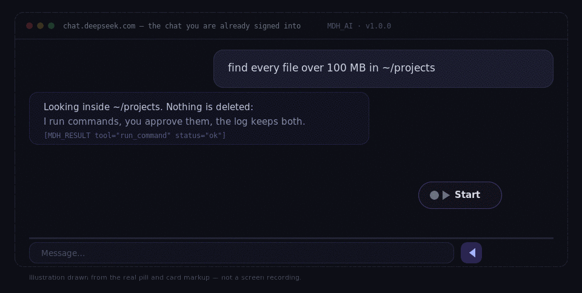
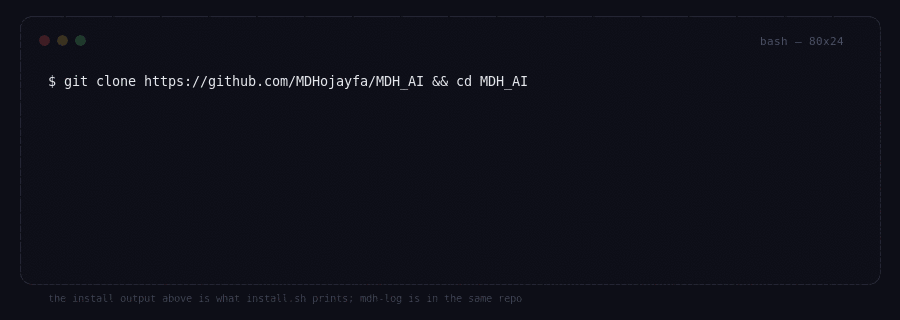
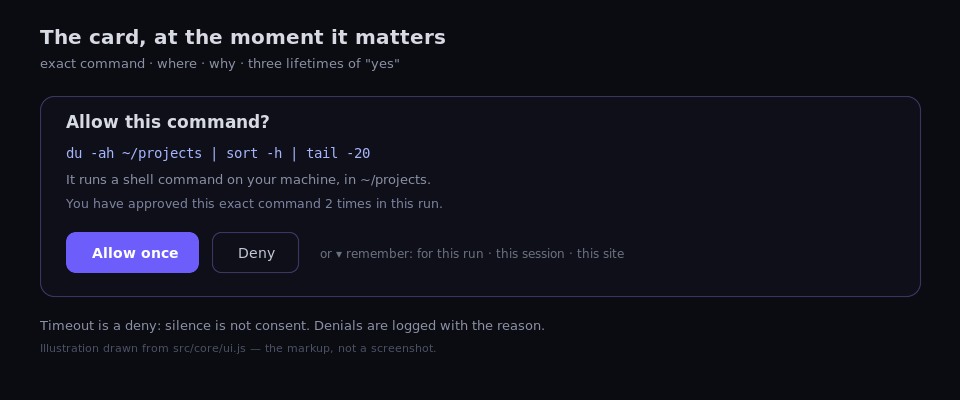

<div align="center">



<h1>MDH_AI</h1>

<p><b>Your chatbot gets a terminal.</b><br>
The chat you are already signed into can read, write, run and search on your Linux machine —<br>
one approval per step, one hash-chained log, no API key anywhere.</p>

<p>


</p>

[Quickstart](#sixty-seconds) · [What it does](#what-it-does) · [Security](#security-in-three-sentences) · [Numbers](#the-numbers-measured) · [Docs](#docs) · [Credits](#credits)

</div>

---

## Why this exists

Every "AI agent for your computer" asks for the same three things first: an API key, a card, and trust in a
gateway you have never read. MDH_AI asks for none of them. The model is the web chat already open in your
browser, running with the session you already paid for or got for free. The only new component is a small host
on your own machine, and it will not touch anything you have not approved.

| | |
|---|---|
| **No API key** | the chat you are signed into *is* the model — nothing to paste, nothing to bill |
| **No account, no daemon** | no gateway, no bot token, no port to keep open; close the browser and it is gone |
| **No `npm install`** | zero dependencies: the host is Node's standard library and this repository |
| **No hidden calls** | loopback only, hash-chained audit on your disk, an approval before anything runs |
| **No heavyweight setup** | 140 KB zipped extension · ~70 ms to a ready host · 55 MB resident — `npm run weigh` measures it, and a budget breaks the build, not a paragraph |

The full comparison against API-key agents, CLI coding agents and self-hosted gateways — **including the things
they do better** — is [`docs/WHY.md`](docs/WHY.md). What comes next is [`docs/V2-NOTES.md`](docs/V2-NOTES.md),
marked as notes, not promises.

## Sixty seconds

```bash
git clone https://github.com/MDHojayfa/MDH_AI && cd MDH_AI
./install.sh                    # builds both browsers, registers the host, checks itself
```

Then load the extension once — Chrome/Brave: `dist/chrome`, Firefox: `dist/firefox` — open any of the eight
chats, and press **Start** on the pill above the composer. Full walkthrough, including the uninstall:
[`docs/MANUAL.md`](docs/MANUAL.md).



## What it does

You type a sentence. The model answers with a call — not prose — and the call is what runs:

```text
you   find every file over 100 MB in ~/projects

model {"mdh_call":{"tool":"run_command","arguments":{"cmd":"du -ah ~/projects | sort -h | tail -20","cwd":"~/projects"}}}

you   ⬛ Allow this command?  du -ah ~/projects | sort -h | tail -20
      Allow once · Deny · remember for this run / this session / this site

host  [MDH_RESULT tool="run_command" status="ok"] … 3 files over 100 MB · 1.2 GB total
```

**Eight chats, zero setup.** ChatGPT · Claude · Gemini · DeepSeek · Kimi · Qwen · GLM (z.ai) · Grok — the free
web UIs, with no plugin from any of them. Chrome 116+, Brave (same artifact), and Firefox 140+ as a first-class
target, not a port of last resort. **Linux only in v1**; the host is the only OS-specific layer and it is small.

**Fifteen builtin tools.** `list_dir` `read_file` `write_file` `edit_file` `run_command` `send_stdin`
`search_files` `file_info` `sys_info` `open_app` `ask_user` `update_plan` `finish`, plus `read_skill` and
`propose_plan`. Every one of them is described to the model and refused outside the allowlist.

**And every MCP server you already have.** Point `~/.config/mdh/servers.json` at any stdio MCP server —
filesystem, git, databases, browser control — and its tools appear under a server prefix. The host speaks the
protocol itself; nothing is bridged or rewritten.

### The parts that make it usable on a bad day

| | |
|---|---|
| **Approval card** | the parsed request is shown, never the model's prose: exact command, folder, why, and how many times you have already approved it in this run |
| **Three lifetimes of "yes"** | *this run* (in memory) · *this session* (ends when the browser restarts, by boot stamp) · *this site* (listed in the popup, removable with ✕). A grant never overrides the policy — it only answers "you already approved this exact command" |
| **A completion code** | every run gets `PHX-XXXXXX`, and only a `finish` carrying it ends the task. A sentence cannot complete a run — [`docs/PLUG.md`](docs/PLUG.md) |
| **Plan first** | read-only mode: investigate, propose a plan, get told yes, then act ([`docs/MANUAL.md`](docs/MANUAL.md) §3a1) |
| **Skills** | write `## deploy` once in your own words; the model sees the names and opens the one it needs |
| **Notes for every run** | up to 1,200 characters of your own instructions — package manager, Python name, folders to leave alone |
| **Runs in the log** | every call carries a run id, so "what did that session actually do?" is a URL (`?run=…`) or `mdh-log --run <id>` |
| **Copy handoff** | a stuck run turns into a prompt you paste into another chat — task, plan, last three results, next step, completion code |
| **Honest failure hints** | a refusal or an error comes with one next action appended as `[MDH_HINT]`, under the untouched error text |
| **Screen-reader audible** | the pill announces its phase through a polite live region; cards move focus and give it back |



## Security in three sentences

**Deny by default.** Paths outside `~/projects`, `~/mdh` and `/tmp/mdh` are refused by two independent guards —
one lexical in the extension, one in the host that resolves symlinks before it opens anything — and `~/.ssh`,
`~/.gnupg`, keyrings and browser profiles are denied by name. **Nothing runs unapproved.** The policy decides,
the card asks, and a timeout is a deny, because silence is not consent. **Everything is recorded.** Every call
lands in `~/.local/state/mdh/audit.jsonl`, hash-chained and carrying *who allowed it* — `auto`, `approval`, or a
named grant — with a checkpoint beside the chain so a shortened log is noticed rather than trusted.

Read the whole threat model, including the residual risk: [`docs/SECURITY.md`](docs/SECURITY.md). The gap list is
not marketing: [`docs/KNOWN-LIMITS.md`](docs/KNOWN-LIMITS.md).

## The numbers, measured

| | |
|---|---|
| extension | **140 KB** zipped · 401 KB unpacked · 40 files |
| host | **~70 ms** to ready · **55 MB** resident · 0 npm dependencies |
| source | 11,300 lines, tests included |
| tests | **283**, run with `node --test tests/*.test.mjs` |
| budgets | 300 KB zip · 80 MB RSS · 1,500 ms startup · 0 dependencies — a build fails when one is crossed |

`npm run weigh` prints that table on your machine, compares the prose in the docs against the real artifact, and
exits non-zero if the two disagree. [`docs/WHY.md`](docs/WHY.md) explains why these numbers are the whole
argument rather than a footnote.

## What it does not do

Linux only in v1 — no Windows, no macOS. It cannot make a free tier generous, so it paces itself and backs off
on refusals instead of hammering your account. A chat site redesign can break an adapter until it is updated
(the page check tells you when that happens, instead of failing silently). It never auto-submits a GitHub issue;
it pre-fills one and stops. And it cannot promise the model is right — only that you see every command before it
runs.

## Docs

| | |
|---|---|
| [`docs/MANUAL.md`](docs/MANUAL.md) | install, first run, approvals, recovery, troubleshooting |
| [`docs/ARCHITECTURE.md`](docs/ARCHITECTURE.md) | the five layers and why each exists |
| [`docs/PLATFORMS.md`](docs/PLATFORMS.md) | per-platform read mode, selectors, quirks |
| [`docs/PLUG.md`](docs/PLUG.md) | the completion code: what ends a task, and why a sentence cannot |
| [`docs/WHY.md`](docs/WHY.md) | the honest comparison, and the measured numbers behind "lightweight" |
| [`docs/RESEARCH.md`](docs/RESEARCH.md) | the sources behind the safety story, and what each one changed |
| [`docs/DECISIONS.md`](docs/DECISIONS.md) | why it is built this way, decision by decision |
| [`docs/TESTPLAN.md`](docs/TESTPLAN.md) | what is tested and how to reproduce it |
| [`docs/RELEASE.md`](docs/RELEASE.md) | the shipping checklist: verify, version in four places, stores |
| [`docs/SECURITY.md`](docs/SECURITY.md) | threat model, controls, residual risk |
| [`docs/DIAGNOSTICS.md`](docs/DIAGNOSTICS.md) | what a failure collects, what it refuses to, the signature table |
| [`docs/SCENARIOS.md`](docs/SCENARIOS.md) | fifteen real failures, walked through from screen to fix |
| [`docs/KNOWN-LIMITS.md`](docs/KNOWN-LIMITS.md) | what one laptop cannot test — the honest version |
| [`docs/V2-NOTES.md`](docs/V2-NOTES.md) | platform rotation and a messaging bridge, written up, not promised |

## Credits

**MDH_AI** is designed and written by **[MDHojayfa](https://mdhojayfa.github.io/)** — extension, host,
installers, docs, the lot. If you report a bug that leads to a fix, or suggest something that ships,
[`CREDITS.md`](CREDITS.md) names you permanently; that is the deal behind every *Send an idea* button in the
product.

The images at the top are **illustrations, not recordings**: they are generated by
[`tools/make-readme-art.mjs`](tools/make-readme-art.mjs) from the same labels, states and buttons the extension
renders, and every frame says so, because a mock passed off as a screenshot is a lie with good typography.

## Licence

MIT. See [`LICENSE`](LICENSE).
